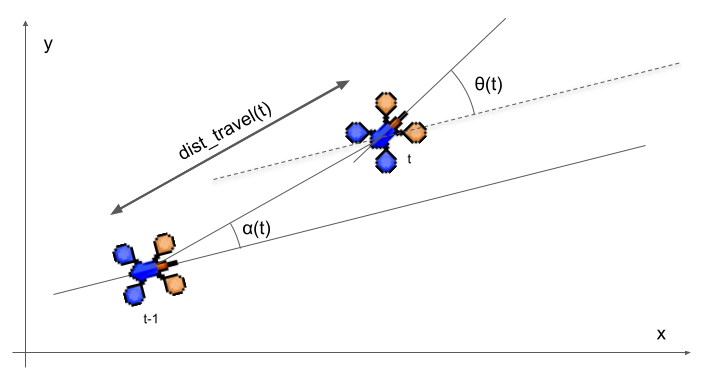

# Table of Contents

- [Welcome to *Swarm-Rescue*](#welcome-to-swarm-rescue)
- [The Competition](#the-competition)
  - [Mission](#mission)
  - [Scoring](#scoring)
- [Simulation Environment](#simulation-environment)
- [Installation](#installation)
- [Getting Started](#getting-started)
  - [Quick Start Example](#quick-start-example)
  - [Minimal Drone Controller Example](#minimal-drone-controller-example)
- [Elements of the environment](#elements-of-the-environment)
  - [Drones](#drones)
    - [Sensors](#sensors)
    - [Actuators](#actuators)
    - [Communication](#communication)
  - [Playground](#playground)
    - [Coordinate System](#coordinate-system)
  - [Wounded Person](#wounded-person)
  - [The Rescue Center](#the-rescue-center)
  - [The Return Area](#the-return-area)
  - [Special zones](#special-zones)
- [Programming Your Drones](#programming-your-drones)
  - [Code Architecture](#code-architecture)
  - [Your Drone's Brain](#your-drones-brain)
    - [The API contract](#the-api-contract)
  - [Useful Directories](#useful-directories)
  - [Evaluation Plan](#evaluation-plan)
    - [What is the Evaluation Plan?](#what-is-the-evaluation-plan)
    - [YAML Configuration Structure](#yaml-configuration-structure)
    - [Quick Start: Running an Evaluation](#quick-start-running-an-evaluation)
    - [Reproducible Runs (Seed)](#reproducible-runs-seed)
    - [Running in Headless Mode (No Display)](#running-in-headless-mode-no-display)
    - [API: EvalConfig and EvalPlan](#api-evalconfig-and-evalplan)
    - [Pre-configured Evaluation Plans](#pre-configured-evaluation-plans)
  - [Code in detail](#code-in-detail)
    - [Project Structure Overview](#project-structure-overview)
    - [Directory *simulation*](#directory-simulation)
    - [Directory *maps*](#directory-maps)
    - [Directory *solutions*](#directory-solutions)
    - [Directory *examples*](#directory-examples)
    - [Directory *tools*](#directory-tools)
  - [Submission](#submission)
  - [Various tips](#various-tips)
    - [Exiting an execution](#exiting-an-execution)
    - [Enable some visualizations](#enable-some-visualizations)
    - [Show your own display](#show-your-own-display)
    - [Create a new map](#create-a-new-map)

- [Contact](#contact)

**Writing a drone?** The interface you code against is documented in
[`API.md`](API.md). Read that first — this README describes the project, the
competition and the environment; `API.md` is the API reference.

# Welcome to *Swarm-Rescue*

With this project, you will try to save human lives, in simulation... Teach a swarm of drones how to behave to save a maximum of injured people in a minimum of time!

Your job will be to develop your own drone controller. In the competition, each participating team will be evaluated on new, unknown maps. The winner will be determined by a scoring system based on multiple criteria: rescue speed, exploration efficiency, number of injured people saved, remaining health of the drones, and more.

*Swarm-Rescue* is the environment that simulates the drones and that describes the maps used, the drones and the different elements of the map.

[Access to the GitHub repository *Swarm-Rescue*](https://github.com/emmanuel-battesti/swarm-rescue) • [Website](https://emmanuel-battesti.github.io/swarm-rescue-website/) • [API reference](API.md) • [Changelog](https://github.com/emmanuel-battesti/swarm-rescue/blob/main/CHANGELOG.md)

The Challenge requires only basic knowledge of *Python* and emphasizes creativity, problem-solving, and algorithmic thinking. Success depends more on innovative approaches to swarm coordination than on advanced programming skills.

# The Competition

## Mission

The objective is simple: explore an unknown area (like the basement of a collapsed building), detect injured people, and guide them to the rescue center.

Each team has a fleet of 10 drones, equipped with sensors and communication devices. Your role is to **program the intelligence of these drones to make them 100% autonomous** by programming them in *Python*.

They will need to collaborate, manage failures, communication losses, and unforeseen events to successfully complete their mission. All development is done **exclusively within this simulation environment**, with maps of increasing complexity.

The final evaluation will be done on several unknown maps designed by the organizers and not available to the contestants. Every proposition will be tested on the same computer and a score related to the performance will be computed.

## Scoring

Depending on the scenario evolution before the final evaluation, the score calculation may be slightly modified.

A mission ends when:
- The maximum simulation timestep is reached (*max timestep limit*).
- The maximum real-world execution time is exceeded (*max walltime limit*, typically 2 to 5 minutes).
When one of the two limits is reached, the game is over. If your algorithm is fast, you will reach the "max timestep limit" first. If your algorithm is too slow, you will reach the "max walltime limit" before the "max timestep limit".

Your score will be calculated based on:
- **✅ Rescued People:** The percentage of injured people brought back to the rescue center.
- **🗺️ Exploration:** The percentage of the map explored.
- **❤️ Drone Health:** The percentage of health points remaining for your drones at the end of the mission.
- **⏱️ Efficiency:** The time remaining if all people are rescued and the whole map is explored.

# Simulation Environment

Swarm-Rescue is built on a modified code of the 2D simulation library [**Simple-Playgrounds**](https://github.com/mgarciaortiz/simple-playgrounds) (SPG), which uses the **Pymunk** physics engine and the **Arcade** game engine.

In practical terms, this means:
- Drones and objects have mass and inertia (they don't stop instantly).
- Collisions are handled by the physics engine.
- The simulator manages a perception-action-communication loop at each time step.

# Installation

Follow [INSTALL.md](INSTALL.md) to set up your environment, install dependencies, and troubleshoot common issues. Supported platforms include Ubuntu (recommended) and Windows (with WSL2 or Git Bash).

# Getting Started

This section will help you quickly set up and run your first simulation with a custom drone controller.

## Quick Start Example

Once installed, you can launch a default simulation with:

```bash
python3 src/swarm_rescue/launcher.py
```

## Minimal Drone Controller Example

Here is a minimal example of a custom drone controller.
Create a new file in the `src/swarm_rescue/solutions/` directory, e.g., `my_great_drone.py`, and add the following code:

```python
from swarm_rescue.simulation.drone.drone_abstract import DroneAbstract

class MyGreatDrone(DroneAbstract):
    def control(self):
        # Simple forward motion at each step
        return {
            "forward": 1.0,  # Move forward at full speed
            "lateral": 0.0,  # No sideways movement
            "rotation": 0.0,  # No rotation
            "grasper": 0      # Don't grasp anything
        }

    def define_message_for_all(self) -> None:
        # Define message content for communication with other drones
        pass
```

Then, modify `src/swarm_rescue/solutions/my_drone_eval.py` to use your new drone:
```python
from swarm_rescue.solutions.my_great_drone import MyGreatDrone
class MyDroneEval(MyGreatDrone):
    pass
```

Now, run the launcher again to see your drone in action!
```bash
python3 src/swarm_rescue/launcher.py
```

# Elements of the environment

## Drones

Drones are a type of **agent** in *Simple-Playgrounds*.
Drones are composed of different body parts attached to a *Base*.

Drones **perceive their surroundings** through two first-person view sensors:
- *Lidar* sensor
- *Semantic* sensor

Drones also have a communication system.

Drones are equipped with sensors that allow them to **estimate their position and orientation**. We have two kinds:
- with absolute measurements: the *GPS* for positions and the magnetic *compass* for orientation.
- with relative measurements: the *odometer* which provides positions and orientation relative to the previous position of the drone.

They are also equipped with life points (or health) that decrease with each collision with the environment or other drones, leading to destruction when reaching zero.
The drone has access to this value with its data attribute *drone_health*.

A collision costs **one health point every 30 simulation steps** (`COLLISION_DAMAGE_COOLDOWN_STEPS`, i.e. one simulated second), and not one per second of real time as it used to. The cooldown is counted in steps so that the damage is part of the simulation and not of the machine that runs it: a run gives the same result in [headless mode](#running-in-headless-mode-no-display) and with a window, however fast the host is.

#### What is left of a destroyed drone

A destroyed drone is not erased: it leaves a **wreck**, and what that wreck does depends on what killed it.

| Cause of death | The wreck | Visible to the sensors? | Blocks the other drones? | How it is drawn |
| --- | --- | --- | --- | --- |
| **Damage** (collisions brought the health to zero) | Spins down, then stays | No | No | See-through |
| **Kill zone** (a special zone of the map) | Spins down, then stays | Yes | Yes | Solid |

A drone destroyed by damage is *gone*, debris included: the wreck is taken out of the uid image the sensors read and out of the physical space, so it neither blocks a drone nor shows up in a lidar ray. A drone destroyed by a kill zone leaves a wreck that stays a solid obstacle and stays reported, exactly as it always was — and **stays destroyed after it leaves the zone**: driving out of a kill zone does not bring a drone back to life.

That difference is also drawn: a wreck the sensors cannot see is semi-transparent, one they can still see keeps the full opacity. It is the only thing on the map a participant cannot check against their own sensors.

A destroyed drone is no longer controlled, and its sensors stop being updated — it is scenery from that point on: it stops drawing its lidar and semantic rays too, since a wreck looking around the map would read as a drone still flying. Its **communicator stops as well**: a wreck neither sends nor receives, and it is not reported as a peer in another drone's `comms_in_range`, so key C no longer draws a link from a living drone to a dead one. This holds for both causes of death. The wreck then briefly spins on itself before coming to rest on the destroyed sprite for the rest of the run.

### Sensors

The full reference — every accessor, every return value, every guarantee — is in
[`API.md`](API.md). This section is the overview; `API.md` is the contract.

| Sensor | Call | Reports |
| --- | --- | --- |
| Lidar | `lidar_values()` | 181 distances, one per ray, max range 300. Walls and obstacles. |
| Semantic | `semantic_values()` | What each detected object **is**, max range 200. |
| GPS | `measured_gps_position()` | Position `(x, y)`, origin at the map center. |
| Compass | `measured_compass_angle()` | Heading in `[-Pi, Pi]`, counter-clockwise. |
| Odometer | `odometer_values()` | Relative motion: distance traveled, and how it turned. |

All of them are noisy, and all of them can be switched off by a special zone, in
which case they return `None`. Always handle `None`.

Two things worth knowing before reading the details:

- **The semantic sensor does not see walls.** It reports wounded persons, the
  rescue center and other drones — nothing else. `TypeEntity.WALL` exists in the
  enum but is never returned. Use the lidar for walls.
- **The odometer is your fallback position.** By integrating it you can estimate
  your position when the GPS is unavailable, which is what makes the No GPS zones
  survivable.

Each sensor is documented in `API.md` section 5, with its field of view, its ray
count, its noise model and worked examples of reading it.

To visualize sensor data, set the matching parameter on the `GuiSR` constructor:
`draw_lidar_rays`, `draw_semantic_rays`, `draw_gps`, or `enable_visu_noises` to
see the noise itself. `enable_visu_noises` also draws the path obtained by
integrating the odometer, which is the quickest way to check your dead-reckoning
is right:



### Actuators

At each time step you return four values:

| Key | Range | Effect |
| --- | --- | --- |
| `forward` | `-1.0` to `1.0` | Force along the longitudinal axis. |
| `lateral` | `-1.0` to `1.0` | Force along the lateral axis. |
| `rotation` | `-1.0` to `1.0` | Rotation speed. Signed. |
| `grasper` | `0` or `1` | Open (0) or close (1). |

To rescue a wounded person you approach them, close the grasper, carry them to
the rescue center, and open it again. Closing the grasper does not by itself mean
the grasp succeeded — `grasped_wounded_persons()` is what reports what you
actually hold.

While carrying someone the drone is slower (`LINEAR_SPEED_RATIO` drops from `3.0`
to `1.0`), and the carried person becomes transparent to your own sensors so they
do not obstruct your view.

The exact contract, including what the simulator does with an out-of-range
command, is in `API.md` sections 3 and 8.

### Communication

Drones exchange messages with every neighbor within `RANGE_COMMUNICATION` = 250
pixels, at each simulation timestep.

- Send: whatever `define_message_for_all()` returns.
- Receive: `self.communicator.received_messages`, a list of `(sender, message)`
  pairs.

The payload is opaque to the simulator — you choose the layout, and it is handed
back unchanged. See `API.md` section 9, and
`src/swarm_rescue/solutions/my_drone_lidar_communication.py` for a working
implementation.

## Playground

Drones act and perceive in a *Playground*.

A *playground* is composed of scene elements, which can be fixed or movable. A drone can grasp certain scene elements.
The playground with all its elements, except for the drones, is called a "Map" within this *Swarm-Rescue* repository.

### Coordinate System

The playground uses a standard Cartesian coordinate system:

* The position `(x, y)` :
  - Origin (0,0) is at the center of the map.
  - `x`: Horizontal position (positive values to the right)
  - `y`: Vertical position (positive values upward)

* The orientation `theta`:
  - Measured in radians between -π and π
  - Increases with counter-clockwise rotation
  - At `theta` = 0, the drone faces right (positive x-axis)

* Map Dimensions:
  - Maps have a size [width, height], with width along x-axis and height along y-axis
  - All measurements are in pixels

## Wounded Person

A *Wounded Person* appears as a yellow character on the map and represents an injured individual requiring rescue.

**Rescue Process:**
1. Detect the wounded person (using the semantic sensor)
2. Approach them
3. Grasp them (set `grasper = 1`)
4. Transport them to the rescue center
5. Release them at the rescue center (set `grasper = 0`)

**Types of Wounded Persons:**
- **Static** (majority): Remain in fixed positions
- **Dynamic**: Move along predetermined paths, following these behaviors:
  - Move back and forth along their defined route
  - If dropped by a drone somewhere off their path, they will move in a straight line attempting to rejoin their original route
  - May be more challenging to rescue due to their movement

A practical example of grasping a wounded person can be found in `examples/example_semantic_sensor.py`.

You can find an example of some dynamic wounded persons in the `examples/example_moving_wounded.py` file.

## The Rescue Center

The *Rescue Center* is a red element on the map where the drones have to bring the *Wounded Person*.

A reward is given to a drone each time it gives a *Wounded Person* to the *Rescue Center*.

You can find an example of rescue center used in the `examples/example_semantic_sensor.py` file.

## The Return Area

The *Return Area* is a blue area on the map where the drones should stay at the end of the mission.
Part of the final score is calculated with this zone: the percentage of health points of the drones that return to this return area at the end of the mission compared to the health points of the drones at the beginning of the mission.
If there is no *Return Area* in the map, then the score is calculated with the percentage of health points of all drones in the map.

This return area is not visible to any sensor, but the boolean data attribute *is_inside_return_area* gives information about whether the drone is inside the return area or not.
The *Return Area* is always near the *Rescue Center* and the drones always start the mission from this area.

## Special zones

There are zones that alter the abilities of the drones. They can also call the *disablers*. They are invisible to sensors!
- **No-Communication Zone (transparent yellow):** Cuts off all radio communication.
- **No-GPS Zone (transparent gray):** The GPS and compass no longer work. Rely on the odometer!
- **Kill Zone (or deactivation zone) (transparent pink):** Instantly destroys any drone that enters it.

# Programming Your Drones

## Code Architecture

Your code is located in the `src/swarm_rescue/solutions` directory. You will only need to modify files in this folder.

An important file is `src/swarm_rescue/solutions/my_drone_eval.py`. This is where you will tell the simulator which drone class to use: the MyDroneEval class must inherit from your drone class.

`src/swarm_rescue/launcher.py` is the main program file to launch a swarm of drones using your code. This file executes everything needed to perform the evaluation: it launches the 10 drones you have customized in the map you want, runs the mission and gives the final score.

## Your Drone's Brain

You must create a class that inherits from `DroneAbstract`. This class is your drone's "brain." It must implement two crucial methods:

1.  `define_message_for_all()`: This is where you define the information the drone will send to its neighbors.
2.  `control()`: This is the core of your logic. This method is called at each time step and must return the actuator commands (move, turn, etc.).

**Golden Rule:** In your code, use **only** sensor data (e.g., `measured_gps_position()`) and not the true simulation values (e.g., `true_position()`). This is essential to prepare for the actual competition conditions where ground truth is not available.

## The API contract

**[`API.md`](API.md) is the reference you code against.** It documents every call
you may make, what it returns, what it returns when a sensor is disabled, and
what the simulator guarantees. This README describes the project; `API.md`
describes the interface, and does not go stale in the same places.

One point is worth repeating here because it surprises people. A drone exposes
more than a solution should use: the simulator itself calls `pre_step()`,
`collide_wall()` and the `draw_*` family on every drone it holds, so those cannot
be made private, and their existence does not make them part of the API. The
supported set is published in code and checked by a test, so it cannot drift:

```python
from swarm_rescue.simulation.drone.drone_abstract import PARTICIPANT_API
```

Two exclusions are deliberate:

- **`true_position()`, `true_angle()`, `true_velocity()`** are the ground truth. Calling them from `control()` or `define_message_for_all()` raises `TrueStateAccessError`: they are still reachable for debugging and for the reporting code, but reading them to decide what to do is cheating, and it would make the simulated sensor noise pointless.
- **Everything else** (`pre_step`, `collide_wall`, `draw_gps`, the `draw_*` family, ...) is framework plumbing. It may change without notice.

See `API.md` section 12 for the full contract, and section 1 for how to debug
with the ground truth without tripping the guard.

## Useful Directories

- `src/swarm_rescue/solutions`: **Your code.** Examples are provided here.
- `src/swarm_rescue/maps`: The available simulation maps.
- `examples/`: Standalone example scripts to understand each feature (controlling a drone with the keyboard, visualizing Lidar, etc.).
- `src/swarm_rescue/tools`: Tools, for example, to create a map from an image.
- `src/swarm_rescue/simulation`: The core of the simulator. **Do not modify these files.**
- `API.md`: The drone API reference.

## Evaluation Plan

### What is the Evaluation Plan?

The evaluation plan defines which scenarios your drones will be tested on. It is fully configurable via a YAML file, allowing you to specify which maps, special zones, and how many rounds to run for each scenario—without changing any Python code.

**Why use it?**
- Evaluators can easily test your solution on many scenarios.
- You can test your own code on custom maps and conditions.
- Output options (reports, videos) are controlled from the same file.

---

### YAML Configuration Structure

Your main configuration file (e.g., `config/default_eval_plan.yml`) should look like this:

```yaml
stat_saving_enabled: true        # Save statistics and generate PDF report (true/false)
video_capture_enabled: false     # Enable video recording of the mission (true/false)

evaluation_plan:
  - map_name: MapIntermediate01
    nb_rounds: 2
    config_weight: 1
    zones_config: []
  - map_name: MapIntermediate02
    nb_rounds: 1
    config_weight: 1
    zones_config: []
  - map_name: MapMedium01
    nb_rounds: 1
    config_weight: 1
    zones_config: []
  - map_name: MapMedium01
    nb_rounds: 1
    config_weight: 1
    zones_config: [NO_COM_ZONE, NO_GPS_ZONE, KILL_ZONE]
  - map_name: MapMedium02
    nb_rounds: 1
    config_weight: 1
    zones_config: [NO_COM_ZONE, NO_GPS_ZONE, KILL_ZONE]
```

**Top-level fields:**
- `stat_saving_enabled`: Save statistics and generate a PDF report (`true`/`false`)
- `video_capture_enabled`: Record a video of the mission (`true`/`false`)

The reports and videos are generated in the `~/results_swarm_rescue` directory; they are primarily intended for the competition evaluator.

**evaluation_plan:**
A list of scenarios, each with:
- `map_name`: The map to use (see `src/swarm_rescue/maps`)
- `nb_rounds`: How many times to repeat this scenario
- `config_weight`: Importance in the final score
- `zones_config`: List of special zones to activate:
  - `NO_COM_ZONE`: Disables drone communication
  - `NO_GPS_ZONE`: Disables GPS positioning  
  - `KILL_ZONE`: Destroys drones that enter
  - Empty list `[]`: No special zones active

### Quick Start: Running an Evaluation

1. Edit your YAML file as needed.
2. Run the launcher with your config:
   ```bash
   python src/swarm_rescue/launcher.py --config config/my_eval_plan.yml
   ```
3. Results (reports/videos) will appear in `~/results_swarm_rescue` if enabled.

### Reproducible Runs (Seed)

By default, each run is different: sensor noise, drone start jitter and randomness differ from run to run. To debug reliably, run with a fixed seed:

```bash
python src/swarm_rescue/launcher.py --config config/my_eval_plan.yml --seed 42
```

With `--seed N`, every round of the evaluation derives its seed deterministically (`N + round number`), so the same command reproduces the same mission: identical entity UIDs, identical drone and element placements, and identical noisy sensor readings — as long as your code is deterministic too. Change the seed to sample a different but repeatable variant of the same plan. Without a seed, the behavior is the historical non-reproducible one.

The same applies programmatically: pass `seed=N` when constructing a `Launcher` or an `EvalPlan`. Without a seed, the behavior is the historical non-reproducible one.

### Running in Headless Mode (No Display)

The simulator supports **headless mode**, which is essential for running evaluations on remote servers without a display or GPU.

#### Basic Usage

Add the `--headless` (or `-H`) flag to run without opening a window:

```bash
python src/swarm_rescue/launcher.py --headless --config config/my_eval_plan.yml
```

**Important:** This command works if you already have an X11 server running (even if hidden). The `--headless` flag tells arcade not to show the window, but it still needs an X11 display to create the OpenGL context.

#### Running on Servers Without Display

If you're on a server without X11 or if you encounter OpenGL/display errors, use `xvfb-run` to create a virtual framebuffer:

```bash
# Install xvfb (if needed)
sudo apt-get install xvfb

# Run with virtual display
xvfb-run -s "-screen 0 1920x1080x24" python src/swarm_rescue/launcher.py --headless --config config/my_eval_plan.yml
```

This allows the simulator to create OpenGL contexts even without a physical display, enabling video capture and rendering in headless environments.

Headless mode is also the fastest way to run a simulation: with a window, the simulator is capped at `FRAME_RATE` (30 steps/s) so that a human can watch it, while headless runs as fast as the CPU allows. See `examples/example_headless.py`, which measures both speeds on your own machine (`python examples/example_headless.py --compare`).

### API: EvalConfig and EvalPlan

You can also create evaluation plans programmatically:

```python
from swarm_rescue.simulation.reporting.evaluation import EvalConfig, EvalPlan
from swarm_rescue.simulation.elements.sensor_disablers import ZoneType

# Create an easy scenario
easy_config = EvalConfig(map_name="MyMapEasy01")

# Scenario with all special zones
hard_config = EvalConfig(
    map_name="MapMedium01",
    zones_config=(ZoneType.NO_COM_ZONE, ZoneType.NO_GPS_ZONE, ZoneType.KILL_ZONE),
    nb_rounds=3,
    config_weight=2
)

# Add scenarios to a plan
plan = EvalPlan()
plan.add(easy_config)
plan.add(hard_config)
```
You can see examples of evaluation plans created programmatically in the `main()` functions of the map files in `src/swarm_rescue/maps/` (e.g., `map_final_2025_26_01.py`).

### Pre-configured Evaluation Plans

The `config/` directory contains ready-to-use evaluation plan YAML files for different competition scenarios:

**Competition-specific configurations:**
- `final_2025_26_eval_plan.yml` - Latest 2025-2026 final maps (MapFinal_2025_26_01/02/03)
- `final_2024_25_eval_plan.yml` - 2024-2025 final maps (MapFinal_2024_25_01/02/03)
- `final_2023_24_eval_plan.yml` - 2023-2024 final maps (MapFinal_2023_24_01/02/03) 
- `final_2022_23_eval_plan.yml` - 2022-2023 final map (MapFinal2022_23)
- `intermediate_eval_plan.yml` - Training maps (MapIntermediate01/02)

Run one of them with:

```bash
python src/swarm_rescue/launcher.py --config config/<plan>.yml
```

Each configuration includes scenarios with progressive difficulty:
- Basic scenarios (no special zones) for algorithm validation
- Individual special zone challenges (NO_COM_ZONE, NO_GPS_ZONE, KILL_ZONE)

Statistics saving and video capture are enabled by default in these configurations for detailed performance analysis.

## Code in detail

### Project Structure Overview

```
private-swarm-rescue/
├── src/
│   └── swarm_rescue/
│       ├── launcher.py
│       ├── solutions/
│       │   ├── my_drone_eval.py
│       │   ├── my_drone_lidar_communication.py
│       │   ├── my_drone_motionless.py
│       │   ├── my_drone_random.py
│       │   └── team_info.yml
│       ├── simulation/
│       │   ├── drone/
│       │   │   ├── drone_sensors.py
│       │   │   └── drone_abstract.py
│       │   ├── ray_sensors/
│       │   │   ├── drone_lidar.py
│       │   │   └── drone_semantic_sensor.py
│       │   ├── gui_map/
│       │   │   └── gui_sr.py
│       │   └── ...
│       ├── maps/
│       └── tools/
├── examples/
├── config/
├── tests/
├── INSTALL.md
├── README.md
└── pyproject.toml
```

### Directory *simulation*

As its name indicates, the folder `src/swarm_rescue/simulation` contains the software for the simulator. The files it contains must *not* be modified.

### Directory *maps*

This directory `src/swarm_rescue/maps` contains the maps used by the drones. New maps may be added as new missions are developed. You can also create your own maps based on existing ones (see [Create a new map](#create-a-new-map)).

Each map must inherit from the class *MapAbstract*.

### Directory *solutions*

This directory `src/swarm_rescue/solutions` will contain your solutions. The code currently there serves as example implementations with simple behavior. Use it as inspiration and go beyond: write code that defines your drones and how they interact with the environment.

Keep in mind that the same code runs on each of the 10 drones. Each drone is an instance of your Drone class, distinguished by `self.identifier` — so never assume a drone is alone.

For your computations in `control()`, use only the sensor and communication data. In particular, use `measured_gps_position()` and `measured_compass_angle()` rather than the ground truth: those values are noisy and may be altered by special zones. The exact rules, including which properties raise and why, are in [`API.md`](API.md).

Example implementations are provided in `src/swarm_rescue/solutions` to help you get started:
- `my_drone_random.py` - Demonstrates basic lidar sensor usage and actuator control
- `my_drone_lidar_communication.py` - Shows how to implement inter-drone communication with lidar
- `my_drone_motionless.py` - A minimal implementation of a stationary drone (useful as a starting template)

### Directory *examples*

In the `examples/` folder at the root of the repository, you will find stand-alone programs to help you understand key concepts. In particular:
- `example_display_lidar.py` shows a visualization of the lidar on a graph, with noise.
- `example_com_disabler.py` demonstrates communication between drones and the effect of *No Com Zone* and *Kill Zone*. When communication is possible, a line is drawn between two drones.
- `example_disablers.py` illustrates each disabling zone.
- `example_gps_disablers.py` demonstrates the effect of *No GPS Zone* and *Kill Zone*. The green circle is the GPS position; the red circle is the odometry-only estimate.
- `example_headless.py` runs a simulation in [headless mode](#running-in-headless-mode-no-display), i.e. without any window. Nothing is displayed, so the simulation is no longer capped at 30 steps/s and runs several times faster. Run it with `--compare` to measure the speed of both modes on your own machine.
- `example_keyboard.py` shows how to use the keyboard for development or debugging. Usable keys include: Up/Down (forward/backward), Left/Right (turn), Shift+Left/Right (lateral), W (grasp), L (lidar rays), S (semantic rays), P (GPS position), C (communication), M (print messages), Q (quit), R (reset).
- `example_mapping.py` shows how to create an occupancy map.
- `example_pid_rotation.py` controls orientation with a PID.
- `example_pid_translation.py` controls translation with a PID.
- `example_return_area.py` uses `is_inside_return_area` to detect whether the drone is inside the return area.
- `example_semantic_sensor.py` shows semantic sensor and actuators, grasping a wounded person and bringing it back to the rescue area.
- `example_static_semantic_sensor.py` illustrates semantic sensor rays with other drones and wounded persons.
- `random_drones.py` shows many drones flying randomly in empty space.
- `random_drones_intermediate_1.py` shows random flying in `map_intermediate_01`.

### Directory *tools*

In `src/swarm_rescue/tools`, you may find utilities to create maps and make measurements — `image_to_map.py` and `check_map.py` are described in [Create a new map](#create-a-new-map). Notably:
- `visualize_uid.py` shows the *uid image*, the picture the lidar and the semantic sensor actually read, where every pixel carries an entity identifier. It writes the raw image, a color-decoded version, and a legend naming every uid, then flags both the uids that no entity owns and the entities drawn away from where they are. Use it when a sensor sees something the window does not show.

## Submission

At the end of the competition, submit your solution to your evaluator. The evaluator will use the same software to assess your solution.

The full rules, including the deadlines for each evaluation step (*evalstep*: *intermediate01*, *intermediate02*, *final*) and the code-cleaning requirements, are in [`submission_guidelines.md`](submission_guidelines.md). **Read it before submitting.**

Provide only:
- The code to run your simulated drone, which must come from the `src/swarm_rescue/solutions` directory.
- The file `team_info.yml`, filled in correctly.
- The project's `pyproject.toml`, updated with any new dependencies your drone requires (added in the `dependencies` list).

The script `create_zip_submission.sh`, at the root of the repository, checks these files and builds the ZIP archive to hand in. It requires `pyproject.toml` (declaring your dependencies) and `src/swarm_rescue/solutions/my_drone_eval.py` to exist, and reads the team fields from `src/swarm_rescue/solutions/team_info.yml`.

## Various tips

### Exiting an execution

- To exit elegantly after launching a map, press `Q` in the simulation window (exits current round).
- To exit the entire program immediately, press `E` in the simulation window (exits all rounds).

### Enable some visualizations

The `GuiSR` class can be constructed with the following parameters (defaults shown):
- `draw_zone`: True. Draws special zones (no com zone, no gps zone, killing zone).
- `draw_lidar_rays`: False. Draws lidar rays.
- `draw_semantic_rays`: False. Draws semantic sensor rays.
- `draw_gps`: False. Draws the GPS position.
- `draw_com`: False. Displays the communication range and links between communicating drones.
- `draw_status_bar`: True. Draws a black band across the top of the window, with the map name on the left and, on the right, the progress of the round (`12.5 % (50/400 timesteps) - 42s/600s - 3/7 wounded`). Each part is shown only when the map has the matching information: a missing timestep or walltime limit leaves that part out, and the rescue count only appears when the map has both a rescue center and wounded persons.
- `print_rewards`: False.
- `print_messages`: False.
- `use_keyboard`: False.
- `use_mouse_measure`: False. Click to print the mouse position.
- `enable_visu_noises`: False.
- `filename_video_capture`: None to disable; otherwise the output video filename.

The status band is window decoration, not map content: it never covers any part
of the map, and it never appears in the uid image the lidars and the semantic
sensor read, nor in the recorded video and the report screenshot.

### Show your own display

In *DroneAbstract*, you can override two functions to draw overlays:
- `draw_top_layer()`: draw on top of all layers.
- `draw_bottom_layer()`: draw below all other layers.

For example, draw the drone identifier by calling `self.draw_identifier()` inside `draw_top_layer()`.

### Create a new map

Creating custom maps is useful to reproduce specific scenarios, stress-test parts of your algorithm, and compare strategies under controlled conditions.
It also lets you prototype challenges (wall layouts, wounded placements, and special zones) before the final evaluation on unknown maps.

To add a new map you must create and add two files in `src/swarm_rescue/maps`:
- `map_<name>.py` — defines the Map class (inherits from `MapAbstract`). In the `__init__` of your Map class paste the initialization lines printed by `image_to_map.py` (for example `self._size_area`, `self._rescue_center`, `self._rescue_center_pos`, `self._wounded_persons_pos`) so the map parameters exactly match the conversion. Implement `build_playground()` to set drones' start positions and to call helper functions that add walls/boxes.
- `walls_<name>.py` — contains the helper functions generated by `image_to_map.py` (the script writes `generated_code.py`). Copy the generated helper functions (for example `add_walls(playground)` and `add_boxes(playground)`) into `walls_<name>.py` and import them from `map_<name>.py`.

Step-by-step workflow

1. Draw your map as a PNG image with clear, consistent colors:
   - Walls: pure black (RGB 0,0,0), ~10 px thick for robust detection.
   - Wounded persons: bright yellow (recommended RGB 255,255,0), about 25–40 px diameter.
   - Rescue center: pure red (RGB 255,0,0).
2. Edit `img_path` in `src/swarm_rescue/tools/image_to_map.py` to point to your PNG and run the script. The tool is interactive and shows intermediate images with OpenCV (`cv2.imshow`); press any key to advance (`cv2.waitKey(0)`). On success it will:
   - write a `generated_code.py` that contains helper functions (walls/boxes), and
   - print a few Python initialization lines in the console.
3. Copy the helper functions from `generated_code.py` into a new file `src/swarm_rescue/maps/walls_<name>.py`.
4. COPY the initialization lines printed in the console into the `__init__` of your `Map` class in `src/swarm_rescue/maps/map_<name>.py`. Important: copy these exact assignments so your map parameters match the converter output:
   - `self._size_area`
   - `self._rescue_center`
   - `self._rescue_center_pos`
   - `self._wounded_persons_pos`
   These values ensure the map dimensions, rescue center placement and wounded persons coordinates are identical to the conversion (the console output from `image_to_map.py` is authoritative).
5. Implement `build_playground()` in `map_<name>.py` to:
   - import and call the helper functions from `walls_<name>.py` to add walls/boxes,
   - define drones' starting area/positions (the converter does not create drone starts automatically),
   - add any return area or extra elements required by your scenario.
6. Validate visually using `src/swarm_rescue/tools/check_map.py` (displays the map without drones and prints coordinates when clicking). After visual validation, run a short simulation to smoke-test the map:
```bash
python3 src/swarm_rescue/launcher.py --config config/my_eval_plan.yml
```
Notes & troubleshooting
- Color detection: `image_to_map.py` detects yellow hues for wounded persons and red for the rescue center using HSV/luma thresholds. If detection fails for a particular shade (for instance yellow vs green), tweak the thresholds inside `src/swarm_rescue/tools/image_to_map.py`.
- Drone start positions: the converter does not set drone starting positions. Add them explicitly in `map_<name>.py` — see existing `map_*.py` examples for idiomatic patterns.
- Exploration score: nothing to do. `ExploredMap` initializes its own walls the first time it needs them (during the first simulated step), and renders the map *without* the drones and the wounded persons. Older versions required a `self._explored_map.initialize_walls(self._playground)` line in every map; forgetting it silently reported an exploration score of 0%. A map with no drone scores 0% too — nothing was explored — but its walls are still measured, so the report images are valid.
- Small elements and thickness: keep walls reasonably thick in the source PNG (~8–12 px) to avoid fragmentation during detection.

# Contact

If you have questions about the code, propose improvements or report bugs, you can contact:
emmanuel . battesti at ensta . fr
